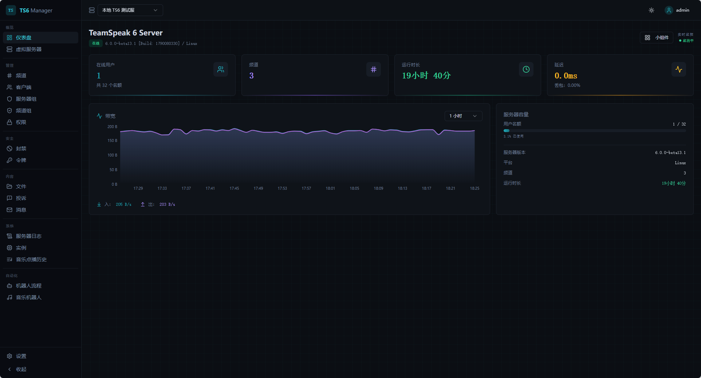
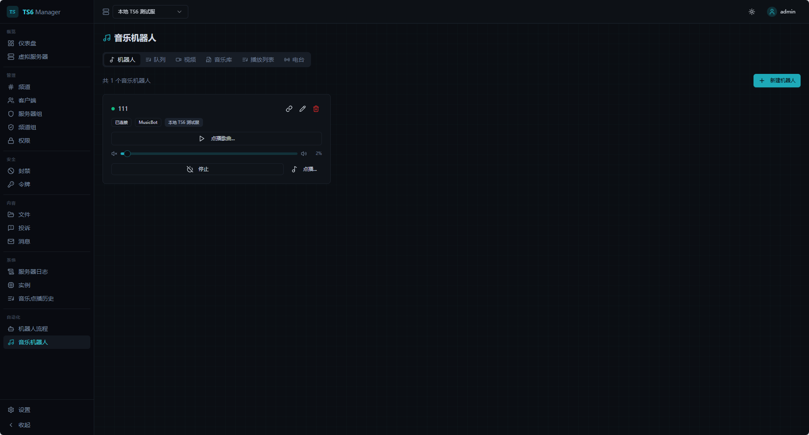
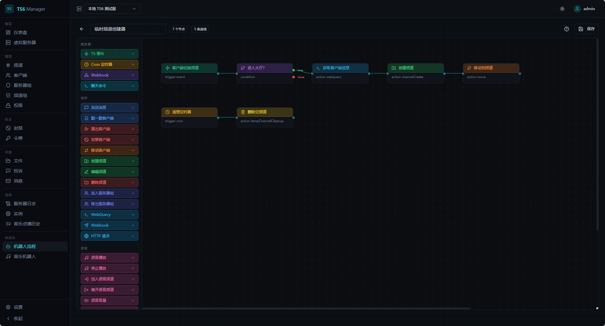
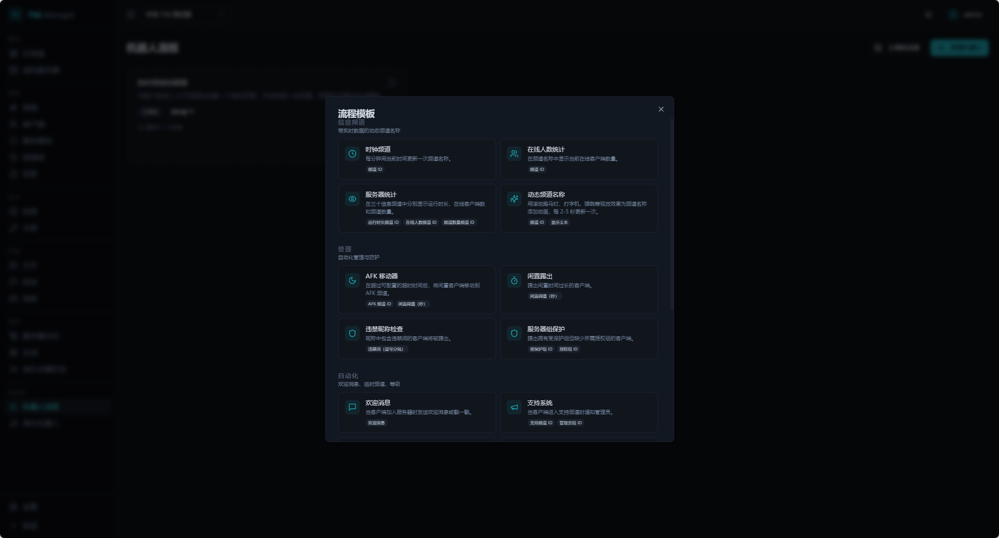

#### 声明：


# TS6 Manager 汉化版

> 本仓库是 [clusterzx/ts6-manager](https://github.com/clusterzx/ts6-manager.git) 的简体中文汉化版，Web 界面已全部翻译为中文。

TeamSpeak 服务器的 Web 管理界面。在浏览器中即可管理虚拟服务器、频道、客户端、权限、音乐机器人、自动化流程，以及可嵌入的服务器小组件。

基于 **WebQuery HTTP API**（现代 TeamSpeak 版本中 ServerQuery 的替代方案）构建，不使用也不支持 Telnet。


## 界面截图

### 仪表盘

服务器实时概览：在线用户、频道数量、运行时长、延迟、带宽曲线与服务器容量，一目了然。



### 音乐机器人

每台服务器可运行多个音乐机器人，每个机器人拥有独立的播放队列、音量控制与播放状态。支持电台流、YouTube 与本地音乐库。机器人所在频道的用户可通过文字命令（`!radio`、`!play`、`!vol` 等）控制播放。



### 机器人流程引擎

可视化节点编辑器，用于搭建服务器自动化流程。将触发器、条件与动作拖到画布上，连线后即可部署。支持 TS3 事件、cron 定时计划、Webhook 与聊天命令作为触发器。



### 流程模板

通过预置流程模板快速上手，覆盖创建临时频道、AFK 移动、闲置踢出、在线人数统计、服务器组保护等常见场景。一键导入后按需修改即可。



## 功能特性

### 服务器管理
- 仪表盘：实时服务器状态、带宽曲线与容量概览
- 虚拟服务器列表，支持启动/停止
- 频道树，支持拖拽排序
- 客户端列表，支持踢出、封禁、移动、戳一戳
- 服务器组与频道组管理
- 权限编辑器（服务器、频道、客户端、服务器组各级别）
- 封禁列表管理
- 令牌 / 权限密钥管理
- 投诉查看器
- 离线消息系统
- 服务器日志查看器，支持筛选
- 频道文件浏览器，支持上传/下载
- 实例级设置

### 音乐机器人
- 单台服务器可运行多个机器人，各自独立队列与播放
- 电台流播放，支持 ICY 元数据与实时曲目标题更新
- 通过 yt-dlp 播放 YouTube（搜索、下载、加入队列）
- 音乐库管理（上传、整理、播放列表）
- 音量控制、暂停、跳过、上一首、随机播放、循环
- 立体声音频，采用稳定的 20ms 节奏控制
- 断线后按指数退避自动重连
- 频道内文字命令，无需切出即可控制
- 音乐点播历史记录

### 视频串流
- 将 YouTube、Twitch 或直链视频实时推送到 TeamSpeak 频道
- 基于 WebRTC，配合 Go sidecar 中继（Pion）实现低延迟分发
- 画质预设（480p、720p、1080p）
- 浏览器内 WebRTC 预览播放
- 通过 RTCP Sender Reports 实现音画同步
- 以 Docker sidecar 容器形式与后端并行运行

### 机器人流程引擎
- 可视化流程编辑器，支持拖拽式节点画布
- 触发器：TS3 事件、cron 定时计划、Webhook（强制校验密钥）、聊天命令（全局或指定频道）
- 动作：踢出、封禁、移动、发送消息、戳一戳、频道创建/编辑/删除、HTTP 请求、WebQuery 命令
- 条件、变量、延迟、循环、日志记录
- 动态频道名（定时滚动文字）
- 占位符系统，支持过滤器与表达式
- 常见自动化任务的内置模板

### 服务器小组件
- 可嵌入网站与论坛的服务器状态横幅
- 基于令牌的公开访问（无需登录鉴权）
- 提供实时页面、SVG 或 PNG 图片三种形式
- 深色与浅色主题
- 可配置显示/隐藏频道树与客户端列表

### 安全
- 首次使用设置向导创建管理员账户（无默认凭据）
- 存储的凭据（API 密钥、SSH 密码）采用 AES-256-GCM 加密
- 所有出站 HTTP 请求与 FFmpeg URL 均具备 SSRF 防护
- 认证接口限流
- JWT 访问令牌 + 刷新令牌轮换，含重用检测
- 基于角色的访问控制（管理员 / 查看者）
- 多租户场景下的按服务器访问控制
- 机器人流程中的 WebQuery 命令白名单（拦截破坏性命令）
- 需鉴权的 WebSocket 连接
- 密码复杂度要求

### 设置与运维
- yt-dlp cookie 文件管理，用于访问有年龄限制或仅会员可见的 YouTube 内容
- 支持上传 cookie 文件或直接在界面中粘贴
- 仅管理员可见的设置面板

## 系统架构

```
┌──────────────┐     ┌──────────────┐     ┌─────────────────┐
│   Frontend   │────▶│   Backend    │────▶│  TS Server      │
│  React SPA   │     │  Express API │     │  WebQuery HTTP  │
│  nginx :80   │     │  Node :3001  │     │  SSH (events)   │
└──────────────┘     └──────┬───────┘     └─────────────────┘
                            │
                     ┌──────┴───────┐
                     │   SQLite     │
                     │   (Prisma)   │
                     └──────────────┘
                            │
                     ┌──────┴───────┐
                     │   Sidecar    │
                     │  Go/Pion     │
                     │  WebRTC :9800│
                     └──────────────┘

Public:  /widget/:token  ──▶  SVG / PNG / JSON (no auth)
```

pnpm monorepo 共 **四个包**：

| 包名 | 说明 |
|---------|-------------|
| `@ts6/common` | 共享类型、常量与工具函数 |
| `@ts6/backend` | Express API、WebQuery 客户端、机器人引擎、语音机器人、小组件 |
| `@ts6/frontend` | 基于 Vite、TailwindCSS、shadcn/ui 的 React SPA |
| `sidecar` | Go 编写的 WebRTC 媒体中继（Pion），用于视频串流 |

所有 TeamSpeak API 调用均由后端代理，前端始终无法直接接触 API 密钥或服务器凭据。

## 技术栈

**前端：** React 18、Vite、TailwindCSS、shadcn/ui、TanStack Query + Table、React Flow、Recharts、Zustand

**后端：** Node.js、Express、Prisma（SQLite）、JWT 认证、WebQuery HTTP 客户端、SSH 事件监听

**语音/音频：** 自研 TS3 语音协议客户端（UDP）、Opus 编码、FFmpeg、yt-dlp

**视频串流：** Go sidecar，Pion WebRTC v4，通过 RTCP Sender Reports 实现音画同步

## 快速开始（Docker）

1. 下载 [`docker-compose.yml`](docker-compose.yml)
2. 在同级目录创建 `.env` 文件：

```env
JWT_SECRET=your-random-secret-at-least-32-characters
ENCRYPTION_KEY=another-random-secret-for-credential-encryption
```

生成安全随机值：

```bash
echo "JWT_SECRET=$(openssl rand -base64 32)" >> .env
echo "ENCRYPTION_KEY=$(openssl rand -base64 32)" >> .env
```

3. 启动服务：

```bash
docker compose up -d
```

> 注意：`docker-compose.yml` 使用的是本仓库自行构建的镜像（`404502/ts6-manager-zh`），
> 由 GitHub Actions 自动构建发布，界面已是中文。首次发布前若镜像尚不存在，
> 请改用下方的[从源码构建](#从源码构建)方式。

4. 打开 `http://localhost:3000/setup`，创建管理员账户
5. 登录后，在 **设置 → 连接** 中添加 TeamSpeak 服务器连接（主机、WebQuery 端口、API 密钥）

> `JWT_SECRET` 为**必填项** —— 生产环境下缺失该变量后端将拒绝启动。
> `ENCRYPTION_KEY` 可选但强烈建议设置 —— 若未设置，将回退使用 `JWT_SECRET` 作为凭据加密密钥。

### 从源码构建

```bash
git clone https://github.com/404-502/ts6-manager.git
cd ts6-manager
echo "JWT_SECRET=$(openssl rand -base64 32)" >> .env
echo "ENCRYPTION_KEY=$(openssl rand -base64 32)" >> .env
docker compose -f docker-compose.local.yml up -d --build
```

### 自行构建 Docker 镜像

本仓库自带 GitHub Actions 工作流 [`.github/workflows/docker-publish.yml`](.github/workflows/docker-publish.yml)：
推送到 `main`（或打 `v*` 标签、手动触发）时，会自动构建 `backend` / `frontend` / `sidecar`
三个镜像并推送到 Docker Hub，同时支持 `linux/amd64` 与 `linux/arm64`。

首次使用需在仓库 **Settings → Secrets and variables → Actions** 中添加两项 secret：

| 名称 | 说明 |
|---|---|
| `DOCKERHUB_USERNAME` | Docker Hub 用户名 |
| `DOCKERHUB_TOKEN` | Docker Hub 访问令牌（Access Token，需读写权限，不要用登录密码） |

镜像名默认为 `<DOCKERHUB_USERNAME>/ts6-manager-zh`，标签为 `backend` / `frontend` / `sidecar`
（`-zh` 后缀标明这是汉化版，避免与上游 `clusterzx/ts6-manager` 混淆）。
若要推送到其他命名空间，在同一页面新增 **Variable** `TS6_IMAGE_NAME`（如 `myorg/ts6-manager-zh`）覆盖。
构建完成后，把 `docker-compose.yml`、`docker-compose.dev.yml`、`docker-compose.coolify.yml`
里的镜像地址改成你自己的即可（本仓库现在填的是 `404502/ts6-manager-zh:*`）。

> 打标签会额外触发一次构建；若只想要一次，请在推送 `main` 前完成版本标记。

### Coolify / 反向代理

可将 [`docker-compose.coolify.yml`](docker-compose.coolify.yml) 作为配置起点。与标准 compose 的关键差异：

- 没有 `ports` 段 —— 由反向代理负责路由
- 在 Coolify 中为 **frontend** 服务设置域名（端口 80）
- 若 TS 服务器运行在独立的 Docker 网络中，需将其作为外部网络挂到 backend 服务上：

```yaml
services:
  backend:
    networks:
      - ts6-network
      - ts-server-net

networks:
  ts-server-net:
    external: true
    name: your-ts-server-network-id
```

## 开发

环境要求：Node.js 20+、pnpm 9+

```bash
pnpm install
pnpm dev          # 并行启动后端与前端
```

后端运行于 `:3001`，前端运行于 `:5173`（Vite 开发服务器）。

### 数据库

使用 Prisma + SQLite。首次运行：

```bash
cd packages/backend
npx prisma migrate deploy
```

Docker 镜像会在启动时自动执行数据库迁移。

## 环境变量

| 变量 | 默认值 | 说明 |
|----------|---------|-------------|
| `JWT_SECRET` | — | **必填。** JWT 签名密钥，生产环境必须设置。 |
| `ENCRYPTION_KEY` | — | 可选。AES-256-GCM 凭据加密的专用密钥，未设置时回退使用 `JWT_SECRET`。 |
| `PORT` | `3001` | 后端端口 |
| `DATABASE_URL` | `file:./data/ts6webui.db` | SQLite 数据库路径 |
| `JWT_ACCESS_EXPIRY` | `15m` | 访问令牌有效期 |
| `JWT_REFRESH_EXPIRY` | `7d` | 刷新令牌有效期 |
| `FRONTEND_URL` | `http://localhost:3000` | CORS 来源 |
| `MUSIC_DIR` | `/data/music` | 音乐文件下载目录 |
| `SIDECAR_URL` | — | 可选。WebRTC sidecar 服务的完整 URL（如 `http://ts6-sidecar:9800`），sidecar 作为独立容器运行时需设置。 |
| `YT_COOKIE_FILE` | — | 可选。yt-dlp 使用的 Netscape 格式 cookies.txt 文件路径，也可通过界面中的 **设置 → YouTube** 管理。 |

## 环境变量 Sidecar（视频串流）

| 变量 | 默认值 | 说明 |
|----------|---------|-------------|
| `VIDEO_QUEUE_SIZE` | `2048` | 视频 RTP 队列大小 |
| `AUDIO_QUEUE_SIZE` | `4096` | 音频 RTP 队列大小 |
| `SYNC_PLAYOUT_BUFFER_MS` | `4` | 供自适应节奏控制使用的小型播放缓冲区 |
| `SYNC_VIDEO_BIAS_MS` | `4` | 可选的视频额外延迟，用于微调同步 |
| `AUDIO_DELAY_MS` | `0` | 旧版 / 手动音频延迟选项。在当前节奏控制逻辑下通常应保持为 0 |
| `SIDECAR_DEBUG_LOGS` | `1` | 开启高频运行时细节的详细调试日志 |
| `VIDEO_READ_RTP_BUFFER` | `4194304` | 视频端口的 UDP 系统套接字缓冲区 |
| `AUDIO_READ_RTP_BUFFER` | `1048576` | 音频端口的 UDP 系统套接字缓冲区 |
| `VIDEO_BUFSIZE` | `1M` | FFmpeg 视频缓冲区 |

## 音乐机器人文字命令

当音乐机器人连接到某频道后，该频道内的用户可通过聊天控制它：

| 命令 | 说明 |
|---------|-------------|
| `!radio` | 列出可用电台 |
| `!radio <id>` | 播放指定电台 |
| `!play <url>` | 通过 YouTube URL 播放 |
| `!play` | 继续暂停的播放 |
| `!stop` | 停止播放 |
| `!pause` | 切换暂停/继续 |
| `!skip` / `!next` | 播放队列中的下一首 |
| `!prev` | 上一首 |
| `!vol` | 显示当前音量 |
| `!vol <0-100>` | 设置音量 |
| `!np` | 显示当前曲目 |

## 运行要求

- TeamSpeak 服务器已启用 **WebQuery HTTP**（非 raw/telnet 模式）
- WebQuery API 密钥（通过 `apikeyadd` 或服务器管理工具生成）
- 对 TS 服务器的 SSH 访问权限（仅机器人流程的事件触发器需要）
- 后端已安装 `yt-dlp` 与 `ffmpeg`（Docker 镜像中已内置）


## 许可证

MIT
